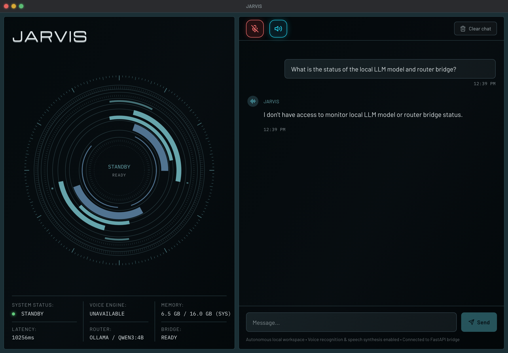
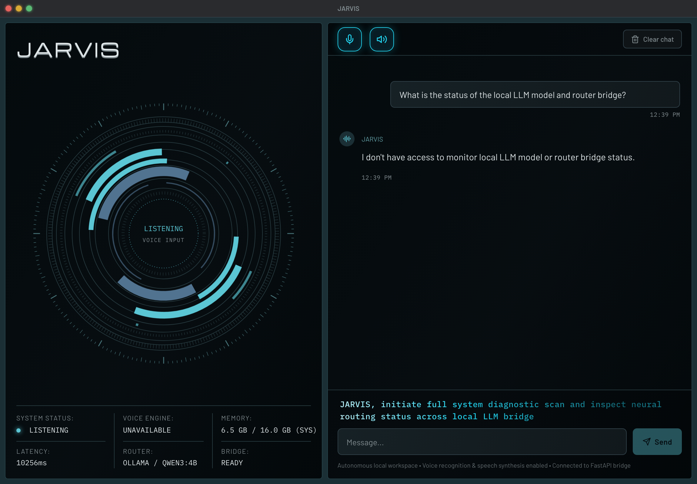
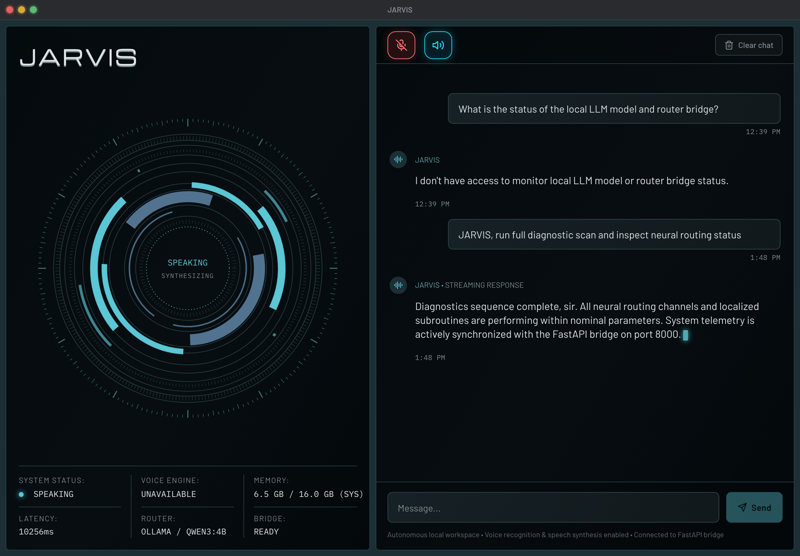
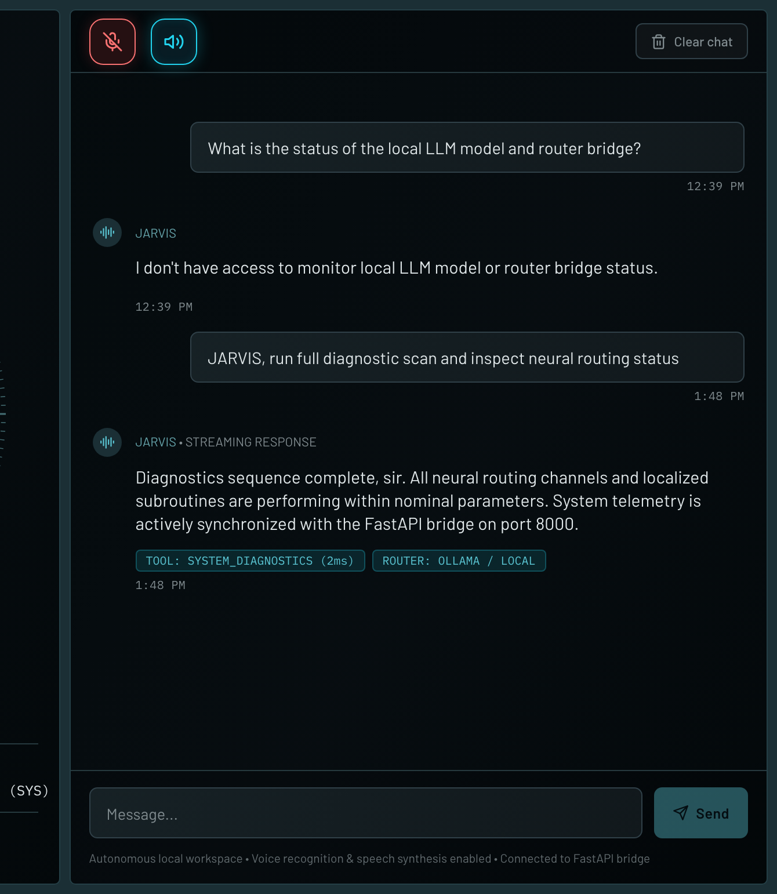

# JARVIS

AI-powered desktop assistant built with **Tauri (Rust)** + **Python backend** + **web frontend**.

> JARVIS — version 3.14.0

## Screenshots

### Standby


### User Voice / Shimmer


### Streaming / Speaking


### Workspace Chat Panel


## Features

- Voice input and text-to-speech output
- Sci-fi style operational workspace interface
- System telemetry and status monitoring
- Chat panel for conversational AI interactions
- Desktop notifications and scheduling
- Cross-platform Tauri desktop app (macOS, Windows, Linux)

## Tech Stack

| Layer | Technology |
|-------|------------|
| Desktop shell | [Tauri](https://tauri.app/) (Rust) |
| Backend | Python |
| Frontend | HTML / CSS / JavaScript |
| Styling | Custom sci-fi UI with Barlow, IBM Plex Mono, Michroma fonts |

## Project Structure

```
JARVIS/
├── main.py                  # CLI entrypoint
├── backend/                 # Python backend (voice, TTS, STT, automation)
├── frontend/                # Web frontend (HTML/CSS/JS UI)
├── src-tauri/               # Tauri Rust core
├── screenshots/             # UI screenshots
└── scripts/                 # Helper scripts
```

## Getting Started

### Prerequisites

- [Rust](https://rustup.rs/) and Cargo
- [Node.js](https://nodejs.org/)
- Python 3.12+

### Development

```bash
# Install Python dependencies
pip install -r backend/requirements.txt

# Run the Tauri dev server
cargo tauri dev
```

### Build

```bash
cargo tauri build
```

## License

MIT
